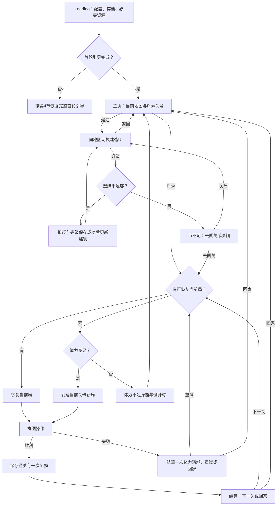
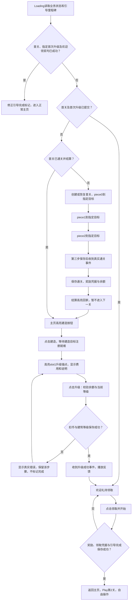

# 五页首版：需求与流程

更新：2026-11-08。状态：用户已授权统一实施，当前处于开发与验收收口；首轮真实流程已有Creator预览证据，但不代表所有边界用例和正式美术交付均已完成。任务状态以开发计划为准。

## 1. 本轮目标和文档关系

在唯一生产工程 `Project/` 中，完成 Loading、主页、建造、拼图、设置及必要弹窗的可玩闭环：闯关获得蜜蜂币，消费升级建筑，保存进度；首次玩家必须走完拼图、首次建造及欢迎领奖引导。

- 产品规则以本文为准；字段、存档、事件、接口见 [配置与技术契约](五页首版_配置与技术契约.md)。
- 任务顺序、并行归属、精简规则和验收见 [开发计划与验收](五页首版_开发计划与验收.md)。
- 本轮取代旧计划中的全量重建框架、67项外围功能、三地图制作及多平台构建要求；旧资料保留作参考，不作为本轮自动扩展范围。
- Tile Busters 参考的是闯关与建设循环、信息层级和引导节奏；本项目保留六角拼图，不复制其牌面玩法或美术。下述数值是本项目配置，不宣称为原作当前精确数值。
- 当前按任务所有权并行实施；规则保持本文定义，实际接口与证据同步到技术契约和开发计划，不因代码或Prefab存在而将未核验项标为完成。

## 2. 范围和复用事实

| 项目 | 首版范围 |
| --- | --- |
| 页面 | 五张效果图对应页面，主页与建造共用地图实例 |
| 题库 | 复用1.0.0正式80普通题、30挑战题，共110题 |
| 编排 | 沿用现有96关顺序，将剩余14挑战题追加为可调编排 |
| 地图 | 实际制作一张，五栋建筑，每栋0～5级 |
| 配置 | 每需求独立Excel，一键合并生成一个配置JSON |
| 引导 | 首关三步强制拼图、领奖回家、进入建造、指定首次升级、欢迎领奖 |
| 存档 | 关卡、钱包、体力、当前局、建筑、奖励凭据、设置和引导 |
| 表现 | 正式Prefab、可用图片和必要Tween反馈；音乐音效内容及Spine后置 |

实施前已核查有效拼图模型、会话、拖放输入、资源/UI框架及110题可复用；当时建造/引导只是视图壳，当前局仅进程内缓存。现在已接入MetaManager、GameStateStore、GameServices、GuideManager及五页正式Prefab，持久状态和真实首轮流程已有测试证据；实施状态与未覆盖边界见开发计划，不再按旧壳状态判断当前能力。

保留全部现有 `assets/scripts/framework/`、有效拼图逻辑、必要公共组件和资源生命周期。旧页面及专属资源按引用清单退役；不把 `arts/`、原始参考、签名和用户存档作为废资源删除。

## 3. 普通游戏流程

FR-001：Loading读取配置、玩家状态及必要资源后才能分流；失败显示原因和重试，不伪装进度完成。仅预加载当前地图及当前关卡所需资源，不等待全部旧功能资源。

FR-002：普通启动进入主页。存在未结束当前局时，Play恢复该局；打开主页和体力不足不会擅自清空当前局。首轮引导未完成时，优先使用第4节恢复规则。

FR-003：主页和建造不是两张独立场景图。切换仅显隐升级锚点、地图标题和底栏，保持同一地图实例、建筑等级、镜头、位置和资源所有权。

FR-004：Play紫色箭头内部显示当前待通关主线序号，右侧显示Play。首版从1开始，不使用效果图的示例56；成功保存后递增，失败不递增。最后一关后显示当前内容完成，不重复刷首通奖励。

## 4. 首轮引导：拼图和建造必须连续完成

FR-005：新首轮完成条件为“首关已结算、指定建筑首次升级成功且欢迎礼领取已提交”。首关胜利、升级成功或播放动画不能单独结束整组引导。已经completed=true的旧存档保留完成状态，不重置余额、不强迫补领或重做教学。

FR-006：首轮顺序固定为拼图教学→真实通关→奖励到账→结算回家→主页点击建造→建造页点击指定建筑升级→真实保存成功→欢迎领奖→奖励与引导完成共同保存→回主页自由操作。首轮结算暂不提供会绕过建造的下一关操作。

FR-007：断点恢复以真实业务状态为准。首关未完成恢复该局；已通关但未升级恢复建造引导；首关奖励凭据与首地图指定槽位首次升级均已保存但未领取欢迎礼时，直接恢复欢迎弹窗，不再次升级扣币；欢迎礼凭据已保存时正常进入主页，不重复发奖。不能以任意地图slot1已升级单独判断完成；异常档只有建筑升级而无首通凭据时仍先完成首关，再恢复并跳过已提交的升级。重入不能重复发首关奖励。

FR-008：首关引导不受体力不足阻断。初始币加首关奖励必须覆盖指定首次升级费用；导表检查该条件。余额异常或写存档失败展示错误及重试，不能静默送币、跳过升级或永久锁屏。

FR-009：引导配置稳定目标ID、触发事件、操作方式、完成事件、提示、手指及遮罩参数。首版支持圆形、矩形、圆角矩形。拖动教学允许从拼块到目标区的完整触摸过程；不是只允许单点点击。

本次引导追加（2026-11-08，实施与验收中）：拖动教学通过GuideSteps.params.highlightProvider=puzzlePlacementPreview调用棋盘原生落点预览，不在引导层重画目标；预览放在棋盘底格之上、已放拼图和拖拽拼图之下，目的区循环透明度呼吸。白手套循环从真实源块指向真实目标，玩家拖动时隐藏演示手，取消/放错恢复；存档成功后推进。引导遮罩对源、目标及真实拖动块镂空。此前18项动效/67项流程/140项自动检查为旧行为基线，不证明本次强制策略和欢迎流程已验收。

FR-010：skippable=false为强制步骤。目标未就绪或暂时丢失时保留阻挡，暂停手型并等待重新注册；超时不解除权限、不伪造完成。错误提供受控重试，恢复后继续本步骤。触摸、拼图选择/落点和统一业务动作入口均校验配置权限；指定拖放只能操作指定块及落点，首关piece0→piece1→piece2连续三步均为强制指定拖放，每步只允许当前块和当前目标；错误落点回托盘不计步。教学全程禁止撤销、返回、设置、重开、提示、托盘翻页，无自由操作剩余拼图阶段。第三步保存并真实胜利后进入结算。回家、建造、升级和欢迎领取分别只开放对应操作。

FR-010A：首次升级成功并播放反馈后，显示单一欢迎领奖弹窗：标题“欢迎来到花园！”，正文“闯关赚取蜜蜂币，建造属于你的花园。”，展示蜜蜂币×100、提示×1，按钮“领取并开始”。无关闭按钮，点击遮罩不关闭；不叠加签到、命名、评分或商城。领取与凭据、引导完成原子保存，失败保留弹窗可重试；成功后回主页，Play显示第2关。体力已在建档时给满，不重复作为礼包展示。

## 5. 五页行为与操作边界

| 页面 | 显示与行为 | 返回／中断 |
| --- | --- | --- |
| Loading | 当前加载进度与状态，完成后按引导分流 | 初始化失败可重试，不进入半初始化业务 |
| 主页 | 头像、蜜蜂币、体力、设置、建造、带关号Play | 侧栏和右下活动入口留空；不做旧路线选关 |
| 建造 | 同地图五个升级锚点、地图名、总进度、礼物、返回 | 返回只换主页UI；不清空地图或建造状态 |
| 拼图 | 返回、设置、棋盘、托盘、必要步数、撤销／重开／提示 | 设置暂停输入；返回可选择继续、保留本局回家、确认放弃 |
| 设置 | 音乐、音效、震动状态及语言选择 | 关闭或确定回到原页面和原局，不能默认跳主页 |

FR-011：必要弹窗包括通关、失败、重开／放弃确认、币不足、体力不足、地图完工。复用设置面板、关闭按钮、币图标和公共按钮，直接制作正式Prefab；不另出整页效果图。

FR-012：设置覆盖实时页面，背景是实际页面加遮罩，不使用烘焙了旧活动按钮或旧Play布局的整页截图。设置界面不能吞掉当前局或刷新建造状态。

FR-013：音乐、音效开关只保存偏好，本轮不制作或补齐音频；震动复用已有平台边界，平台不支持时安全无操作。语言显示当前选择并接现有可用本地化，不将未提供语言做成假入口。

FR-014：页面、弹窗、建筑视觉单元、体力组件和引导层均有正式Prefab及组件绑定；运行生成棋盘几何和建筑实例允许，但不能用运行时补整页UI代替交付。

## 6. 拼图与主线

FR-015：保留1.0.0正式110题的几何内容，普通与挑战规则分别沿用。现有96关编排作为初始顺序，14道储备挑战题追加；顺序、奖励以后由主线Excel调整。

FR-016：整块拖动、吸附预览、非法位置弹回、取回、撤销和提示使用同一个会话权威。旧版缺失能力按需迁入，不恢复依赖旧节点路径或广告的整套旧UI。

FR-017：托盘默认完整显示三枚拼块。4～7块的关卡支持横向滑动，所有未放置块可自由选取；不丢弃拼块、不强迫按三块队列放置。滑动与拖块要有明确手势区分，并验证横滑后开始拖动。

FR-018：首版循环箭头定义为“重开”，覆盖历史效果图说明中的“旋转”称呼。本轮不新增六十度旋转规则。重开先确认，再结束旧局并按体力规则创建新局；取消确认不改任何数据。

FR-019：普通题不强加效果图的18步限制；挑战题使用题目步数限制。最后允许步恰好完成时判胜，不先判失败。无效拖动和滑动托盘不算成功放置。

FR-020：撤销以取回最近放置的拼块实现，沿用取回计1步、不返还历史步数的规则；没有可取回块时不操作、不计步。提示显示目标轮廓及必要冲突提示，不自动放置、不计步；首次成功激活扣1提示，同一激活提示重复点击或恢复不重复扣。提示不足使用公共弹窗，本轮不接商城或广告。具体语义和旧版核查依据见技术契约，避免UI和模型分别计算。

FR-021：成功结算保存通关、当前关号和一次奖励后才开放下一关。每个尝试及首通奖励均有凭据；重启、重复打开结算和重复点击不能重复发奖。

## 7. 体力与经济

| 常量／数值 | 首版值 | 属性 |
| --- | --- | --- |
| `energyRecoverSeconds` | 300秒，即每点5分钟 | 用户明确要求，放常量Excel |
| `energyMax`、`energyInitial` | 5、5 | 已采纳的首版默认，可配 |
| `energyFailureCost` | 1 | 失败／放弃／重开的消耗，可配 |
| 初始蜜蜂币 | 0 | 开发初始默认，可调 |
| 首关蜜蜂币奖励／引导首次升级费 | 100／40 | 保证引导可完成的开发样例，可调 |
| 初始提示／普通通关蜜蜂币 | 5／100 | 可调首版默认 |
| 欢迎礼 | 100蜜蜂币、1提示、0体力 | 首次升级后一次领取；Rewards配置 |
| 领取欢迎礼后的样例状态 | 160币、5/5体力、6提示、Play第2关 | 首关100－升级40＋欢迎100；不代表竞品数值 |
| 每栋升入1～5级费用 | 40、60、80、100、120 | 五类建筑统一的可调首版默认，逐行配表 |
| 地图完工奖励 | 100蜜蜂币、1提示 | 可调首版默认，只领一次 |

FR-022：开始新局检查体力，不立即扣除；胜利不扣。失败、确认放弃或重开扣1点，同一次尝试最多扣一次。失败后点击重试只检查新局条件，不再次扣旧局消耗；体力不足不能创建新局。

FR-023：有有效未结束当前局时允许恢复，不因恢复重复检查入场或扣费。正常切后台、关闭应用及保留本局回家不算失败。已失败或已放弃的局不可作为有效局恢复。

FR-024：体力使用持久时间戳计算。离线15分钟恢复3点，最多到上限；满值不储存额外恢复次数，满值后再次消耗才开始新的5分钟。界面开启、前台恢复和启动均校正倒计时。

FR-025：缺体力时新一次消耗不得重置正在运行的恢复倒计时。时钟回拨不能产生负体力或额外恢复；具体本地时钟策略见技术契约，不宣称具备联网防作弊。

FR-026：币不足弹窗显示拥有、需要和差额，提供去闯关及关闭。去闯关进入当前局或新局检查；若体力不足，显示体力弹窗而不是悄悄跳过条件。首版不提供未接通的充值、广告或商城入口。

## 8. 建造和地图

FR-027：首版实际交付一张地图、五个槽位；建筑初始0级，每栋默认升到5级，总进度由配置计算，当前为0～25。效果图中的6/25、2350币、56关均为演示值，不写入新存档。

FR-028：每个槽位可配置建筑ID、坐标、缩放、层序、升级锚点偏移；每级配置费用、独立素材和表现标识。更换地图或升级不能靠替换整页截图表达状态。

FR-029：升级检查当前等级和余额，扣币与新等级一起保存，成功后更新建筑、圆点、下一价格和总进度。连点不能购买同一级两次；失败不保留虚假余额、建筑或引导完成状态。

FR-030：满级建筑隐藏升级费用并显示完成状态。总进度达到上限后礼物可领取一次；领取奖励及凭据共同保存，重新打开页面不能重复领取。

FR-031：配置有有效下一地图时，领取完工奖励后可进入下一地图；首版没有下一地图时保留完工地图，显示后续开放。不能越界加载、重复重置第一张地图或丢失已完成记录。

## 9. 配置方式

FR-032：常量、地图、地图建筑、建筑等级、主线、奖励、新手引导各自为独立Excel，分别为 `Constants.xlsx`、`Maps.xlsx`、`MapBuildings.xlsx`、`BuildingStages.xlsx`、`Mainline.xlsx`、`Rewards.xlsx`、`GuideSteps.xlsx`。

FR-033：参考并迁入只读 `island/meta_dev` 打表工具，沿用说明／类型／字段前三行、第四行起数据的习惯；每文件只有首个数据工作表参与导出。统一BAT只生成一份 `game-config.json`，游戏初始化由精简MetaManager加载查询。

FR-034：导表检查类型、重复ID、外键、费用、资源、地图五槽、连续等级、主线和引导链。错误指出文件、行和字段；失败不覆盖上次可用JSON。现有拼图几何数据继续复用，不要求策划在Excel输入大段几何JSON。

## 10. 美术接入与后续动画

正式源交付唯一目录为 `Project/arts/`；实际游戏只接入所需运行资源到 `Project/assets/`。保持853×1844设计基准及新效果图风格，已有可用母件优先复用。

| 资源项 | 首版处理与检查 |
| --- | --- |
| 当前地图 | 取得同构图裸背景，再组合独立建筑；禁止在已画建筑的整图上重复叠建筑 |
| 建筑0～5级 | 优先复用已有五类建筑的等级图；核对色光、比例、接触阴影、锚点与遮挡 |
| 公共UI | 复用按钮、设置面板、金币、圆点、礼物、关闭；缺少状态用同风格最小派生 |
| 体力 | 新增爱心、数字和倒计时组件，主页及需要的拼图位置复用；不挤占棋盘 |
| 棋盘与托盘 | 复用几何与母件，保证三块完整、4～7块可操作，阴影不被托盘前沿裁切 |
| 文字与数值 | Label绑定本地化及业务数据；除既有登记主标题外不烘焙入图 |
| 设置 | 直接覆盖实时游戏画面，旧背景中的活动按钮不得残留 |

FR-035：美术准备和代码可并行；临时占位只用于内部联调，最终首版仍须检查实际素材、Prefab、资源引用、原图对照及交互。PNG、PSD、页面对照和正式清单整理可并行推进，不能把功能通过写成正式美术已验收。

| 后补动画 | 首版替代 | 后续交付记录 |
| --- | --- | --- |
| 蜜蜂待机／胜利 | 头像/静态图；角色动画后补 | 骨骼资源、动画名、循环及挂点 |
| 建筑升级 | 即时切级图并刷新圆点/费用；缩放淡入后补 | 触发升级成功事件、动画名和完成回调 |
| 金币与礼物 | 数字/领取状态变化；飞币和图标Tween后补 | 起终点、层级、可否打断 |
| 引导手指 | 白色手套约1.95秒循环拖动、按钮轻点及完整目的区呼吸；无需Spine，已通过Creator专项操作检查 | GuideSteps.presentation、目标注册ID、手指触点标定、循环和退出清理 |

## 11. 完成边界与风险

首版验收必须实际走通：首次拼图→奖励到账→回家→建造→首次升级→解除引导；普通启动主页、连续下一关、币不足回流、体力恢复、地图一次奖励和重启恢复。完整用例见开发计划。

不在本轮：网页配表或拼图编辑器、额外地图及全新等级美术、无尽／活动／任务／社交、商城广告支付、音乐音效内容、Spine成品、多平台构建发布、包体专项优化。保留已有框架不表示恢复这些旧业务。

主要风险为裸背景取得、旧建筑与新图融合、横滑托盘与拖块手势兼容、存档失败及引导断点。发现风险时在任务中记录和修复，不通过裁掉旧题、跳过建造引导或省略真实Creator预览宣称完成。

### 首关三步强制教学追加（最新用户要求，验收待更新）

首关固定连续执行ftue-drag（piece0）→ftue-drag-2（piece1）→ftue-drag-3（piece2），每步在GuideSteps.xlsx分别配置pieceId、targetCell、源/目的目标和highlightProvider。各拖动步allowedActions=["puzzle:drag"]；没有自由放置剩余块或教学撤销，非当前块、错落点以及返回/设置/撤销/重开/提示/托盘翻页均被拦截。错误松手回托盘且不计步。第三步持久保存并收到真实通关事件后，经ftue-win（allowedActions=[]，仅等待事件）进入结算→回家→建造→指定升级→欢迎领奖。

断点恢复按已保存placements对照每一步pieceId/targetCell，取最早未完成步骤；第1步或第2步后重进分别继续第2步或第3步，不重复已保存操作。旧未完成存档若stepId仍为ftue-win而三块尚未正确放完，回到最早未完成教学；旧completed=true仍正常进入主页。新增验收必须覆盖三块分别选中/落点限制、错放计步不变、第1/2步重载和旧ftue-win恢复，历史单次拖放证据不视作三步通过。欢迎奖励、体力和正常游戏规则保持不变。

### 2026-11-09 托盘自动补位与缓动

拼图成功放入棋盘且提交保存后，托盘只排列未放置块，按原题顺序向左连续补位；取消、非法落点、保存失败均保留原托盘顺序。固定三个显示槽位和初始统一缩略尺寸，不因块数减少放大。剩余块移动使用约0.22秒cubicOut缓动；动画期间禁止抓取托盘块与翻页，完成后恢复，撤回按原顺序重新插入。多屏托盘随剩余数量缩短内容宽度并限制滚动范围，保留可见位置，不强制每次回第一页。

初次进入与断点恢复直接展示紧凑布局；隐藏、切关和销毁结束所属动画。连续状态更新不能重启动画；新变化从当前实际位置继续。首关第二、第三步提示读取按pieceId查询的当前槽位，等待托盘补位结束后再显示手型与源区，期间强制输入限制仍有效。验收与实际证据随开发计划同步。

### 2026-11-09 固定障碍格补充

棋盘的obstacleCells使用原版1.0.0的pic2/4.png铆钉金属格，不再以普通底格灰度代替。障碍始终固定在关卡坐标，不进入托盘、不响应拖动、不属于待覆盖目标；拼图不可覆盖，错放不计步。所有有障碍的既有关卡统一生效，无需改题库。

### 2026-11-09 拼图操作按钮辨识改版

底部从左到右仍为撤销上一步、重玩当前关卡、消耗提示。参考用户提供Tilebuster浅色立体底板与大图标比例重新绘制：撤销为蓝色左回退箭头，重玩为青色循环箭头包围金色六边形，提示为放大镜查看金色拼块。三图标无文字；下方分别独立显示撤销/重玩/提示，避免重玩被误认作拼块旋转。提示数量为右上角独立动态文本；重玩仍先确认，未新增旋转功能。

### 2026-11-10 返回主页与撤销图标区分

用户指出顶部返回与底部撤销均为回转箭头，现将公共firstrelease.ui.back（历史back.png）改为珊瑚红底乳白小房子，去除箭头与金币装饰；语义为返回主页。底部firstrelease.ui.undo仍为蓝色回退箭头，表示撤销一步。保持已有UUID、294×323画布、按钮尺寸/位置和动作，拼图顶部先展示暂停选择，可保留本局回家；建造返回共用同一个小房子。正式源、运行副本、实际PSD图层与资源入口同步。
